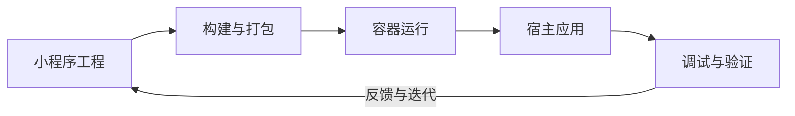

  

<h1 align="center">Weapp Container</h1>

<strong>小程序跨端运行的基座，让开发到交付形成闭环。</strong>

小程序工程 · 容器运行时 · 宿主 SDK · 调试验证

Weapp Container 面向希望在自有应用中承载小程序的开发者，连接小程序工程与宿主应用：业务围绕熟悉的小程序模型开发，由容器承接执行、渲染与会话管理，再通过 SDK 接入原生应用或跨端框架。

## 从工程到应用的闭环

[weapp-vite](https://github.com/weapp-vite/weapp-vite) 负责小程序工程化与构建，Weapp Container 承接构建产物的打包、运行和宿主接入，让小程序业务能进入自有应用，并把运行中的问题带回开发过程。

- **承接业务产物**：将小程序构建产物转换为可校验的 portable pack，交给容器加载。
- **提供运行基座**：管理逻辑执行、页面渲染、导航、存储与会话生命周期。
- **连接宿主能力**：通过 SDK 嵌入页面，以消息和显式宿主方法接入应用已有的账号、网络与设备能力。
- **支持持续迭代**：结合开发预览、设备联调和验证反馈，检查业务在目标宿主中的实际表现。

## 选择接入入口

| 你的宿主 | 仓库 | 主要内容 |
| --- | --- | --- |
| Android | [sdk-android](https://github.com/weapp-container/sdk-android) | Kotlin 会话、原生视图与宿主通信 |
| iOS | [sdk-ios](https://github.com/weapp-container/sdk-ios) | Swift 会话、UIKit / SwiftUI 视图与宿主通信 |
| 桌面应用 | [sdk-desktop](https://github.com/weapp-container/sdk-desktop) | C/C++ 接入层与桌面宿主适配 |
| Flutter | [sdk-flutter](https://github.com/weapp-container/sdk-flutter) | Dart Controller、容器 Widget 与原生适配 |
| React Native | [sdk-react-native](https://github.com/weapp-container/sdk-react-native) | Fabric / TurboModules 接入层 |
| 自研宿主与工具 | [sdk-contract](https://github.com/weapp-container/sdk-contract) | 共享 C ABI、TypeScript 类型与适配协议 |

从对应 SDK 的 README 开始，确认目标平台要求、配套运行库版本和接入步骤。项目仍处于 preview 阶段，各端支持范围与实际验证状态以对应仓库文档为准。

## 开放与许可

SDK 封装层与共享协议以 **Apache-2.0** 开源；核心运行时保持闭源，以单独授权的二进制提供。运行时非商业用途免费，商业用途须取得书面商业授权并按约定付费，具体以所获副本附带的 `RUNTIME-LICENSE` 及适用协议为准。公开 SDK 源码不包含运行库，也不授予私有运行库的下载权限。

接入问题与建议请提交到对应 SDK 仓库的 Issues。
